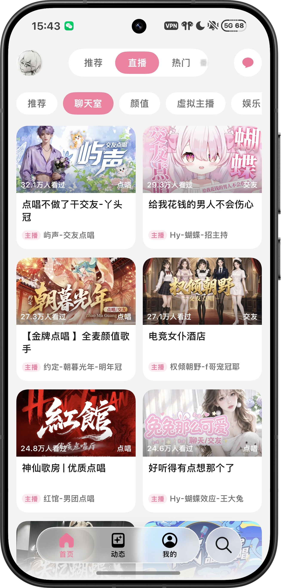
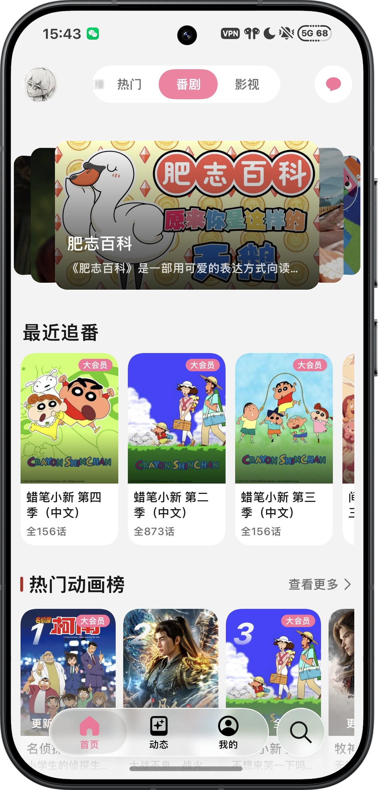
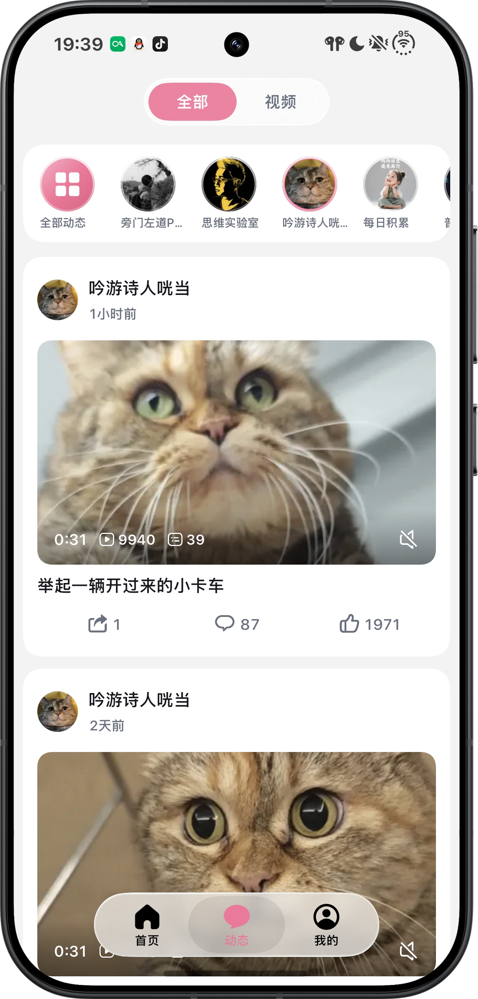
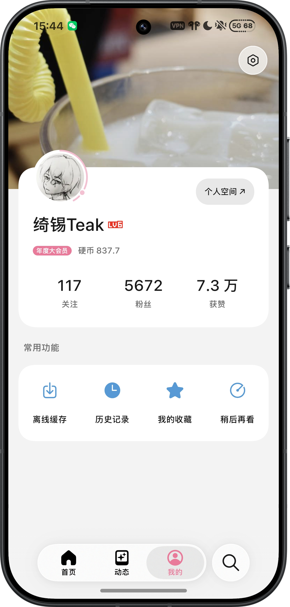
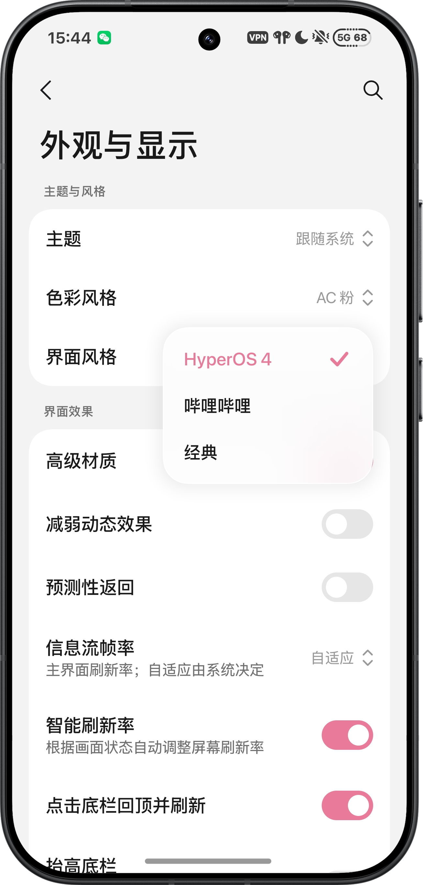

# bdFun

<p align="center">
  
</p>

<p align="center">
  <a href="https://github.com/QxTeak/bdFun/releases"></a>
  <a href="https://github.com/QxTeak/bdFun/releases"></a>
  
  
  
  
  
</p>

bdFun 是一个第三方哔哩哔哩 Android 客户端，使用 Kotlin + Jetpack Compose 编写，致力于轻快、流畅、简洁、美观的使用体验。

> 本项目为第三方非官方客户端，与哔哩哔哩（上海宽娱数码科技有限公司）及其关联方无任何隶属、授权或合作关系。项目仅用于学习、研究与技术交流，不提供、不包含、不传播任何破解内容、付费内容绕过机制或会员权益破解功能。

## 这个仓库是个人二改

本分支（`app`）是 [@maochenyu-me](https://github.com/maochenyu-me) 对上游 [QxTeak/bdFun](https://github.com/QxTeak/bdFun) 的**私人二改**，不是上游官方版本。

- **仅自用。** 改动按我自己的使用习惯来，不保证通用性，也不承诺维护节奏。
- **只在一台 iQOO 11 上验证过**（竖屏视频、深色/浅色主题、分屏与画中画只在真机上试过一遍）。其他机型、其他 Android 版本没测过，也没做适配。
- **不提供成品安装包。** 想要用请从源码自行构建，环境和步骤见下文「[构建](#构建)」。
- 上游 `main` 分支保持镜像不改，所有二改都在 `app` 分支上。

### 二改内容

以下功能是上游没有、或者形态不同的部分：

| 功能 | 说明 |
|---|---|
| 设置备份与恢复 | 设置页新增「备份」：把设置项、我的页布局与搜索历史导出成一个文件，可选择性包含当前账号登录态（含登录态时必须口令加密）；导入只覆盖文件里包含的项，其余保持现状 |
| 竖屏全屏播放器 | 竖屏视频不再被强制横屏。全屏后铺满画面，顶部返回/首页/更多，右侧竖排点赞、评论、投币、收藏、分享，左下作者与标题，底部进度与控制行；进评论时视频收缩为上半屏小窗、评论在下方展开，可一键收回继续播 |
| 首页顶部轮播封面 | 推荐页顶部按官方比例轮播视频封面，可关闭直接看普通视频流；可选静音自动播放，点开进入详情 |
| 刷新撤回 | 刷新推荐流后显示撤销按钮，可恢复刷新前的内容；另有「刷新保留旧推荐」「上次刷新提示」「定位按钮停留时间」三个独立开关 |

此外修了一些上游的小问题，并尽量回提 PR（例如后台播放时返回键抢在搜索层之前、重复的贡献者条目）。能提的都提到上游，提不了或者上游暂时不接受的才留在本分支。

### 与 BiliPai 的关系

竖屏播放器、首页轮播这类改动的**形态与交互参考**自 [BiliPai](https://github.com/jay3-yy/BiliPai)（[@jay3-yy](https://github.com/jay3-yy)），但代码是按 bdFun 自己的分层与 TeakUI 组件重写的，不是直接移植。

竖屏播放器目前是自研版本；如果上游作者之后支持了竖屏，会改用上游实现并删掉这里的代码。

## 界面预览

<p align="center">
  
  
  
  
</p>
<p align="center">
  
  
  
  
</p>

采用 HyperOS 4 的设计风格。

## 安装

系统要求：Android 13+（`minSdk 33`，`targetSdk 37`）。

**本分支不提供安装包**，请按下文自行构建。构建出来的包名：

- debug：`com.aritxonly.bdfun.debug`（与 release 共存，不会互相覆盖）
- release：默认 `com.aritxonly.bdfun`；本分支自用打包用 `-Ppkg=com.aritxonly.bdfun.fork` 覆盖成独立包名，方便和上游正式版装在同一台机器上

## 反馈

上游的通用问题请直接提给 [QxTeak/bdFun](https://github.com/QxTeak/bdFun)（[Telegram 群组](https://t.me/+tQrDYf-hb702ZjM1)、QQ 群 852442572）。只跟本分支二改有关的问题提到本仓库的 Issue 即可，我随缘看。

## 构建

> 下面这段是我在自己机器上实际走通的步骤（Windows + JDK 21 + Android SDK 37）。其他平台同理，把 `gradlew.bat` 换成 `./gradlew` 即可。

### 1. 环境

| 项 | 版本 / 说明 |
|---|---|
| JDK | 21（AGP 9.5.1 要求，低版本直接报错） |
| Android SDK | Platform 37、Build Tools 37.0.0（`compileSdk 37` / `minSdk 33`） |
| Gradle | 用仓库自带的 Wrapper，不要用系统 Gradle |
| Python 3 | 仅用于 `tools/setup-miuix.py` 准备 Miuix 快照，以及 `tools/` 下的分层检查脚本 |

在项目根目录建 `local.properties` 指向 SDK（AS 打开过项目的话会自动生成）：

```properties
sdk.dir=/path/to/Android/Sdk
```

### 2. 准备 Miuix 本地快照（必做）

项目通过 composite build 引用**本地 Miuix 源码**，Maven 上的 `miuix-glass:0.9.4` 不含需要的那部分代码，缺了会直接报 `Could not find top.yukonga.miuix.kmp:miuix-glass`。

```bash
python3 tools/setup-miuix.py
```

脚本把固定快照 `45645854cd46c32275c5666e3aafa9980d8f104e` 放进被 Git 忽略的 `.local/`，Gradle 会自动使用。也可以手动指定：

```powershell
# PowerShell（Windows）
$env:MIUIX_SOURCE = "D:\path\to\miuix-45645854cd46c32275c5666e3aafa9980d8f104e"
```

```bash
# bash
export MIUIX_SOURCE=/path/to/miuix-45645854cd46c32275c5666e3aafa9980d8f104e
```

快照必须和 `AGP 9.5.1 / Kotlin 2.4.21 / Compose 1.12.2` 对齐，composite build 不能混 AGP 版本。

### 3. 打 debug 包（自己装着玩）

```bash
./gradlew :app:assembleDebug
```

产物：`app/build/outputs/apk/debug/app-debug.apk`，包名 `com.aritxonly.bdfun.debug`。

### 4. 打 release 包（自用签名）

release 需要签名，两种配置方式任选其一：

**方式 A：`keystore.properties`（推荐，文件不进仓库）**

在项目根目录创建 `keystore.properties`：

```properties
storeFile=keystore/your-release.jks
storePassword=******
keyAlias=your-alias
keyPassword=******
```

`storeFile` 相对项目根目录，`keystore/` 已在 `.gitignore` 里。

**方式 B：环境变量**

```powershell
$env:ANDROID_KEYSTORE_PATH = "D:\keys\your-release.jks"
$env:KEYSTORE_PASSWORD     = "******"
$env:KEY_ALIAS             = "your-alias"
$env:KEY_PASSWORD          = "******"
```

两种都没配时会退回 debug 签名（只能本地调试，不要拿去装别人机器）。

然后打包（自用包名 + 版本号）：

```powershell
# PowerShell：带 -P 的参数一定要整体加引号，否则会被拆成任务名
.\gradlew.bat :app:assembleRelease "-Ppkg=com.aritxonly.bdfun.fork" "-PreleaseVersion=1.0.0"
```

```bash
# bash
./gradlew :app:assembleRelease -Ppkg=com.aritxonly.bdfun.fork -PreleaseVersion=1.0.0
```

- `-Ppkg=` 覆盖包名（默认 `com.aritxonly.bdfun`），`-Ppkg` 也会取消 debug 的 `.debug` 后缀
- `-PreleaseVersion=` 支持 `x.y.z` 或 `preview-y.z`，`versionCode` 由它推导
- 产物：`app/build/outputs/apk/release/app-release.apk`（R8 混淆 + 资源压缩已开启）

装到手机：

```bash
adb install -r app/build/outputs/apk/release/app-release.apk
```

> 版本号、构建时间、源码 revision 会打进 `BuildConfig`，装完可在「设置 → 关于 → 版本」里核对是不是刚构建的那份。

### 5. 测试

```bash
./gradlew :danmaku-engine:test            # 弹幕引擎，最快
./gradlew :core:domain:test               # 纯逻辑
./gradlew :app:testDebugUnitTest          # app 层
./gradlew :app:assembleDebug              # 最终必须过
```

分层与尺寸守卫：`python3 tools/check-layering.py`（或 Gradle `checkLayering`）。

## 项目结构

```text
app/              主应用（包名 com.aritxonly.bdfun）
TeakUI/           Compose 页面效果组件库
danmaku-engine/   基于 BiliPai / bytedance DanmakuRenderEngine 的弹幕渲染模块
```

TeakUI 是为方便开发而抽出的 Compose UI 组件库：把页面骨架、玻璃材质、顶部组件和动效统一收敛成一套组件，开发时直接调用，避免每个页面重复实现。它包含基于 Hyper-PiliPlus 的 HyperOS 4 风格 Tab 栏、顶部玻璃组件动画，以及基于 Miuix 的统一页面能力，包括渐进式模糊、大/小标题折叠动画等。

`danmaku-engine` 是 4.0 引入的独立弹幕渲染模块，负责弹幕解析、轨道计算和绘制，保留上游 Apache-2.0 版权与许可说明。

更多页面规范见 `TeakUI/docs/PAGE_CHROME_SPEC.md`，第三方来源清单见 `TeakUI/docs/PROVENANCE.md`。

## 致谢

bdFun 使用了 / 参考了以下项目，感谢作者和社区的工作：

- [Hyper-PiliPlus](https://github.com/AritxOnly/Hyper-PiliPlus)（[@AritxOnly](https://github.com/AritxOnly)，fork [@Mutx163](https://github.com/Mutx163)）：玻璃材质、折射、阴影、底栏弹簧、ProgressiveTopBar 等
- [HyperIsland](https://github.com/1812z/HyperIsland)（[@1812z](https://github.com/1812z)）：渐进模糊参数观感参考，关于页背景移植
- [PiliPlus](https://github.com/bggRGjQaUbCoE/PiliPlus)（[@bggRGjQaUbCoE](https://github.com/bggRGjQaUbCoE)）：功能与交互参考，投币界面实现
- [Miuix](https://github.com/compose-miuix-ui/miuix)（[@compose-miuix-ui](https://github.com/compose-miuix-ui)）：Compose UI / 玻璃 blur 依赖
- [AndroidLiquidGlass](https://github.com/Kyant0/AndroidLiquidGlass)（[@Kyant0](https://github.com/Kyant0)，Apache-2.0）：柔光玻璃组件使用了其中部分渲染管线能力，包括折射着色器的圆形透镜轮廓与圆角矩形 SDF 思路
- [Shapes](https://github.com/Kyant0/Shapes)（[@Kyant0](https://github.com/Kyant0)，Apache-2.0）：使用 `Capsule()` 胶囊形状，用于玻璃表面、导航栏、Tab 指示器等
- [bilibili-API-collect](https://github.com/SocialSisterYi/bilibili-API-collect)（[@SocialSisterYi](https://github.com/SocialSisterYi)）：哔哩哔哩接口资料
- [BiliPai](https://github.com/jay3-yy/BiliPai) / [bytedance DanmakuRenderEngine](https://github.com/bytedance/DanmakuRenderEngine)：弹幕实现移植，视频收起功能移植，功能与交互参考
- [FodFluidRipple](https://github.com/Leaf-lsgtky)（[@Leaf-lsgtky](https://github.com/Leaf-lsgtky)）：水波纹动画
- [Guiyuan](https://github.com/CHS-Haple/Guiyuan)（[@CHS-Haple](https://github.com/CHS-Haple)）：开始页移植
- [Telegram Android](https://github.com/TelegramMessenger/Telegram-Android)（[@TelegramMessenger](https://github.com/TelegramMessenger)）：图片查看器移植
- HyperOS 4：一镜到底动效
- AndroidX / Jetpack Compose、Media3 / ExoPlayer、OkHttp、Coil、Kotlin / kotlinx.coroutines、ZXing

感谢所有上游项目作者与贡献者。

## 许可证

本项目以 **GNU General Public License v3.0** 发布，完整文本见 [LICENSE](LICENSE)。

Copyright (C) 2026 bdFun contributors

你可以自由使用、修改、再分发，但需要：

1. 保留 `LICENSE`、`THIRD_PARTY_NOTICES.md`、`TeakUI/docs/PROVENANCE.md`；
2. 对外分发修改版时，按 GPL-3.0 提供对应完整源码；
3. 不额外添加与 GPL-3.0 冲突的限制。

第三方依赖与许可说明见 [THIRD_PARTY_NOTICES.md](THIRD_PARTY_NOTICES.md)。

## 免责声明

- 本项目按“现状”提供，不对稳定性、可用性、安全性作任何保证。
- 所有视频、音频、图片、弹幕等内容版权归哔哩哔哩及相应权利人所有，本项目不主张任何内容权利。
- 因官方接口变更、策略调整或不可抗力导致的功能失效或损失，开发者不承担责任。
- 使用本项目即表示你已阅读并同意完整的使用须知；如不同意，请停止使用并删除本项目。

### 固定 Miuix 快照

`miuix-glass` 来自 `45645854cd46c32275c5666e3aafa9980d8f104e` 快照，不能假定 Maven 上的 `0.9.4` 包含它。
先运行 `python3 tools/setup-miuix.py`（也可用 `--source /path/to/snapshot` 复制本机快照）。
源码存入被 Git 忽略的 `.local/`，Gradle 自动使用；仍可通过 `MIUIX_SOURCE` 或 `-PmiuixSource=` 覆盖。
快照采用 Apache-2.0 许可证，脚本保留其 LICENSE；不把临时路径写进版本库。

核心边界验证：`python3 tools/check-layering.py`，或运行 Gradle `checkLayering`。
